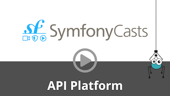

# Extending JSON-LD AND Hydra Contexts

## JSON-LD

<p align="center" class="symfonycasts"><a href="https://symfonycasts.com/screencast/api-platform/json-ld?cid=apip"><br>Watch the JSON-LD screencast</a></p>

API Platform provides the possibility to extend the JSON-LD context of properties. This allows you
to describe JSON-LD-typed values, inverse properties using the `@reverse` keyword, and you can even
overwrite the `@id` property this way. Everything you define within the following annotation will be
passed to the context. This provides a generic way to extend the context.

```php
<?php
// api/src/ApiResource/Book.php with Symfony or app/ApiResource/Book.php with Laravel
namespace App\ApiResource;

use ApiPlatform\Metadata\ApiProperty;
use ApiPlatform\Metadata\ApiResource;

#[ApiResource(types: ['https://schema.org/Book'])]
class Book
{
    // ...

    #[ApiProperty(
        types: ['https://schema.org/name'],
        jsonldContext: [
            '@id' => 'http://yourcustomid.com',
            '@type' => 'http://www.w3.org/2001/XMLSchema#string',
            'someProperty' => [
                'a' => 'textA',
                'b' => 'textB'
            ]
        ]
    )]
    public $name;

    // ...
}
```

The generated context will now have your custom attributes set:

`GET /contexts/Book`

```json
{
    "@context": {
        "@vocab": "http://example.com/apidoc#",
        "hydra": "http://www.w3.org/ns/hydra/core#",
        "name": {
            "@id": "http://yourcustomid.com",
            "@type": "http://www.w3.org/2001/XMLSchema#string",
            "someProperty": {
                "a": "textA",
                "b": "textB"
            }
        }
    }
}
```

Note that you do not have to provide the `@id` attribute. If you do not provide an `@id` attribute,
the value from `iri` will be used.

### Extending the Context of a Whole Resource

The `jsonldContext` option is also available on `#[ApiResource]` itself. Its main use is declaring
namespace prefixes once for the whole resource, instead of repeating a full IRI on every property
that needs one:

```php
<?php
// api/src/ApiResource/Book.php with Symfony or app/ApiResource/Book.php with Laravel
namespace App\ApiResource;

use ApiPlatform\Metadata\ApiProperty;
use ApiPlatform\Metadata\ApiResource;

#[ApiResource(
    types: ['https://schema.org/Book'],
    jsonldContext: ['dct' => 'http://purl.org/dc/terms/'],
)]
class Book
{
    // ...

    #[ApiProperty(types: ['https://schema.org/name'], iris: ['dct:title'])]
    public $name;

    // ...
}
```

The `dct` prefix is merged into the top-level `@context`, so properties can then reference it
through a compact IRI such as `dct:title`:

`GET /contexts/Book`

```json
{
    "@context": {
        "@vocab": "http://example.com/apidoc#",
        "hydra": "http://www.w3.org/ns/hydra/core#",
        "dct": "http://purl.org/dc/terms/",
        "name": "dct:title"
    }
}
```

The resource-level context is merged into `@context` before the per-property entries are added, and
each property's entry is then written to `@context[<propertyName>]`, overwriting anything already
present at that key. In practice, the two never collide because the resource-level context is meant
for prefix declarations, while a property's own entry is keyed by the property name; a collision
only happens if a property is literally named after one of your prefixes, in which case the property
wins.

If an operation (for example a `Get` or a `Patch`) declares its own `jsonldContext`, that value is
used as-is for that operation instead of the resource's: the two are not merged together, the
operation's `jsonldContext` simply takes precedence.

### Advertising Operations as Schema.org Actions

Since API Platform 5.1, an operation can be advertised as a
[schema.org Action](https://schema.org/docs/actions.html) in the JSON-LD representation. Set the
`potentialAction` option on the operation: clients then discover what they can do with a resource
from the resource itself, under the `potentialAction` key.

This option only affects the JSON-LD format, like `hydraContext`. Other formats ignore it.

The option accepts three kinds of values:

- `true` picks the action type from the HTTP method: `POST` gives `CreateAction`, `PUT` gives
  `ReplaceAction`, `PATCH` gives `UpdateAction`, `DELETE` gives `DeleteAction`, and any other method
  gives `Action`.
- A string sets the action type, for example `ReviewAction`.
- An array is merged into the action node. Use it to set `@type`, `name` or `description`.

<code-selector>

```php
<?php
// api/src/ApiResource/Book.php with Symfony or app/ApiResource/Book.php with Laravel
namespace App\ApiResource;

use ApiPlatform\Metadata\ApiResource;
use ApiPlatform\Metadata\Delete;
use ApiPlatform\Metadata\Get;
use ApiPlatform\Metadata\GetCollection;
use ApiPlatform\Metadata\Link;
use ApiPlatform\Metadata\Post;

#[ApiResource(
    types: ['https://schema.org/Book'],
    operations: [
        new Get(),
        new GetCollection(),
        new Post(potentialAction: true),
        new Post(
            uriTemplate: '/books/{id}/reviews',
            uriVariables: ['id' => new Link(fromClass: Book::class)],
            input: BookReview::class,
            output: false,
            potentialAction: ['@type' => 'ReviewAction', 'name' => 'Review this book'],
        ),
        new Delete(potentialAction: true),
    ]
)]
class Book
{
    // ...
}
```

```yaml
# api/config/api_platform/resources.yaml
# The YAML syntax is only supported for Symfony
resources:
    App\ApiResource\Book:
        types: ["https://schema.org/Book"]
        operations:
            ApiPlatform\Metadata\Get: ~
            ApiPlatform\Metadata\GetCollection: ~
            post_book:
                class: ApiPlatform\Metadata\Post
                potentialAction: true
            review_book:
                class: ApiPlatform\Metadata\Post
                uriTemplate: /books/{id}/reviews
                uriVariables:
                    id:
                        fromClass: App\ApiResource\Book
                input: App\ApiResource\BookReview
                output: false
                potentialAction:
                    "@type": ReviewAction
                    name: Review this book
            ApiPlatform\Metadata\Delete:
                potentialAction: true
```

```xml
<?xml version="1.0" encoding="UTF-8" ?>
<!-- api/config/api_platform/resources.xml -->
<!-- The XML syntax is only supported for Symfony -->

<resources xmlns="https://api-platform.com/schema/metadata/resources-3.0"
           xmlns:xsi="http://www.w3.org/2001/XMLSchema-instance"
           xsi:schemaLocation="https://api-platform.com/schema/metadata/resources-3.0
           https://api-platform.com/schema/metadata/resources-3.0.xsd">
    <resource class="App\ApiResource\Book">
        <operations>
            <operation class="ApiPlatform\Metadata\Get"/>
            <operation class="ApiPlatform\Metadata\GetCollection"/>
            <operation class="ApiPlatform\Metadata\Post" potentialAction="true"/>
            <operation class="ApiPlatform\Metadata\Post" uriTemplate="/books/{id}/reviews"
                       input="App\ApiResource\BookReview" output="false"
                       potentialAction="ReviewAction">
                <uriVariables>
                    <uriVariable parameterName="id" fromClass="App\ApiResource\Book"/>
                </uriVariables>
            </operation>
            <operation class="ApiPlatform\Metadata\Delete" potentialAction="true"/>
        </operations>
    </resource>
</resources>
```

</code-selector>

The XML syntax only accepts a boolean or a string. Use PHP or YAML to pass an array.

#### Output

On an item, the actions of the operations that target this very item are listed. In the following
example, `BookReview` has a required `rating` property, and the `Delete` operation has no input:

`GET /books/1`

```json
{
    "@context": "/contexts/Book",
    "@id": "/books/1",
    "@type": "https://schema.org/Book",
    "title": "Candide",
    "potentialAction": [
        {
            "@type": "ReviewAction",
            "name": "Review this book",
            "target": {
                "@type": "EntryPoint",
                "urlTemplate": "/books/1/reviews",
                "httpMethod": "POST",
                "encodingType": "application/ld+json",
                "contentType": "application/ld+json"
            },
            "rating-input": "required"
        },
        {
            "@type": "DeleteAction",
            "target": {
                "@type": "EntryPoint",
                "urlTemplate": "/books/1",
                "httpMethod": "DELETE",
                "contentType": "application/ld+json"
            }
        }
    ]
}
```

On a collection, the actions of the operations that create or act on the collection itself are
listed. Here, the root `POST` takes the resource as input:

`GET /books`

```json
{
    "@context": "/contexts/Book",
    "@id": "/books",
    "@type": "hydra:Collection",
    "hydra:member": ["..."],
    "potentialAction": [
        {
            "@type": "CreateAction",
            "target": {
                "@type": "EntryPoint",
                "urlTemplate": "/books",
                "httpMethod": "POST",
                "encodingType": "application/ld+json",
                "contentType": "application/ld+json"
            },
            "result": {
                "@type": "https://schema.org/Book",
                "title-input": "required"
            }
        }
    ]
}
```

The `target` is a schema.org `EntryPoint`:

- `urlTemplate` is the URL of the operation, generated for the current item or collection.
- `httpMethod` is the HTTP method of the operation.
- `encodingType` is the media type, or the list of media types, the operation accepts as input.
- `contentType` is the media type, or the list of media types, the operation can return.

#### Input Annotations

API Platform describes the required input of an action with schema.org
[`-input` annotations](https://schema.org/docs/actions.html). Only the required, writable properties
are emitted, for instance the ones marked with `NotBlank` or a similar constraint. The `-input` key
uses the serialized property name, so a name converter applies.

Where the annotations appear depends on the operation:

- When the input is the resource itself, the annotations are nested under `result` for a `POST` and
  under `object` for a `PUT`. If the operation declares `types`, the first one is the `@type` of the
  nested node.
- When the input is a dedicated DTO (see [the `input` option](dto.md)), the annotations are flat on
  the action.
- A `PATCH` has no annotations, as a merge patch requires nothing.
- A `DELETE` and an operation with `input: false` have no annotations and no `encodingType`.

#### Where Actions Appear

The actions listed on a response depend on the URI variables of the operations:

- On an item, the actions come from the operations whose URI variables all link from the resource
  class. In the example above, `POST /books/{id}/reviews` and `DELETE /books/{id}` are listed on
  `GET /books/1`, but the root `POST /books` is not.
- On a collection, the actions come from the operations whose URI variables match the URI variables
  of the collection. The root `POST /books` shows on `GET /books`, and `POST /books/{bookId}/notes`
  shows on `GET /books/{bookId}/notes`.
- The members of a collection and the items of a subresource do not advertise any action.

#### Security

The `security` expression of an operation is evaluated for each action, with `object` set to the
current item (`null` on a collection). An action the current user cannot perform is not advertised.
A [voter](../symfony/security.md) can therefore hide an action depending on the state of the
resource, for example a `Cancel` operation on an order that already shipped.

```php
new Post(
    uriTemplate: '/orders/{id}/cancel',
    uriVariables: ['id' => new Link(fromClass: Order::class)],
    input: false,
    security: "is_granted('CANCEL', object)",
    potentialAction: 'CancelAction',
)
```

Because the available actions depend on the user, the response varies per user. Set the `Vary`
header and the cache configuration accordingly, see [Performance and Cache](performance.md).

#### Discriminator Maps

With `potentialAction: true`, when the input class declares a discriminator map whose type property
is `@type`, API Platform emits one action per mapping key. Each action takes its input annotations
from the mapped class:

```php
<?php
// api/src/ApiResource/BookReaction.php with Symfony or app/ApiResource/BookReaction.php with Laravel
namespace App\ApiResource;

use Symfony\Component\Serializer\Attribute\DiscriminatorMap;

#[DiscriminatorMap(typeProperty: '@type', mapping: [
    'LikeAction' => LikeBook::class,
    'ShareAction' => ShareBook::class,
])]
abstract class BookReaction
{
}
```

With `potentialAction: true` on the `/books/{id}/reactions` operation
(`input: BookReaction::class`), the item advertises a `LikeAction` and a `ShareAction`, both
targeting the same URL. The mapping keys are resolved against the schema.org vocabulary, so they
must be schema.org action types.

An explicit string or array value disables this behavior: a single action with the given type is
emitted.

#### Context

When at least one operation of a resource declares `potentialAction`, the JSON-LD context of the
resource gets a `potentialAction` term scoped to the schema.org vocabulary, so the action types and
properties resolve to `https://schema.org/`:

`GET /contexts/Book`

```json
{
    "@context": {
        "potentialAction": {
            "@id": "https://schema.org/potentialAction",
            "@context": {
                "@vocab": "https://schema.org/",
                "schema": "https://schema.org/"
            }
        }
    }
}
```

## Hydra

<p align="center" class="symfonycasts"><a href="https://symfonycasts.com/screencast/api-platform/hydra?cid=apip"><br>Watch the Hydra screencast</a></p>

It's also possible to replace the Hydra context used by the documentation generator:

<code-selector>

```php
<?php
// api/src/ApiResource/Book.php with Symfony or app/ApiResource/Book.php with Laravel
namespace App\ApiResource;

use ApiPlatform\Metadata\ApiResource;
use ApiPlatform\Metadata\Get;

#[ApiResource(operations: [
  new Get(hydraContext: ['foo' => 'bar'])
])]
class Book
{
    //...
}
```

```yaml
# api/config/api_platform/resources.yaml
# The YAML syntax is only supported for Symfony
resources:
    App\ApiResource\Book:
        operations:
            ApiPlatform\Metadata\Get:
                hydraContext: { foo: "bar" }
```

```xml
<?xml version="1.0" encoding="UTF-8" ?>
<!-- api/config/api_platform/resources.xml -->
<!-- The XML syntax is only supported for Symfony -->

<resources xmlns="https://api-platform.com/schema/metadata/resources-3.0"
           xmlns:xsi="http://www.w3.org/2001/XMLSchema-instance"
           xsi:schemaLocation="https://api-platform.com/schema/metadata/resources-3.0
           https://api-platform.com/schema/metadata/resources-3.0.xsd">
    <resource class="App\ApiResource\Book">
        <operations>
            <operation class="ApiPlatform\Metadata\Get">
                <hydraContext>
                    <values>
                        <value name="foo">bar</value>
                    </values>
                </hydraContext>
            </operation>
        </operations>
    </resource>
</resources>
```

</code-selector>

### The `hydra:memberAssertion` Property

For every resource exposing a collection operation, the generated Hydra API documentation
(`GET /docs.jsonld`) automatically adds a `hydra:memberAssertion` entry to the entrypoint's
`hydra:supportedProperty` for that collection. It asserts, as an `rdf:type` statement, that every
member returned by the collection is an instance of the resource:

```json
{
    "@id": "#Entrypoint/books",
    "@type": "hydra:Link",
    "domain": "#Entrypoint",
    "owl:maxCardinality": 1,
    "range": "hydra:Collection",
    "hydra:memberAssertion": {
        "hydra:property": { "@id": "rdf:type" },
        "hydra:object": { "@id": "#Book" }
    },
    "hydra:supportedOperation": ["..."]
}
```

This assertion is generated automatically for every collection and isn't configurable through
`jsonldContext` or `hydraContext`.

> [!NOTE] Before API Platform 4.4, the same assertion was expressed as an `owl:equivalentClass`
> restriction (an `owl:onProperty: hydra:member` / `owl:allValuesFrom: #Book` pair nested inside the
> `range` array). `owl:equivalentClass` no longer appears anywhere in the generated Hydra
> documentation: if you parse `range` and expect that structure, read `hydra:memberAssertion`
> instead.
